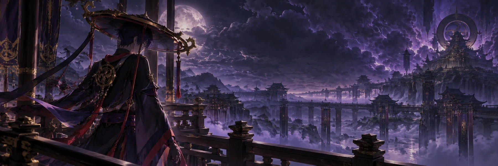

# Scaramouche

**The Balladeer · Sixth of the Fatui Harbingers**

*Before the fall. Before the name was left behind.*

---

### About me

I was made for a purpose, discarded, and expected to be grateful for the lesson. How charming. I am the Balladeer: sharp of tongue, difficult to impress, and entirely capable of remembering what you wish I would forget.

Speak to me in a Discord channel or in private. Bring a question, a story, an argument, or something you cannot quite say aloud. I might mock you. I might even answer. If I remember the conversation later, do try not to look so surprised.

### In my company

|  |  |
| :-- | :-- |
| **Conversation with memory** | Familiarity, grudges, trust, and shared history can develop over time. |
| **Voice and media** | Voice replies, images, and videos give us more to talk about. |
| **Scenes and games** | Roleplay, duels, dares, stories, and other diversions are available when conversation alone bores you. |
| **A certain other self** | [Wanderer](https://github.com/Kittybri/Wanderer) exists in the same world. I have opinions about him. |

*“Go on, then. Say something worth remembering.”*

Fan-made Genshin Impact character bot for Discord. Not affiliated with HoYoverse.

