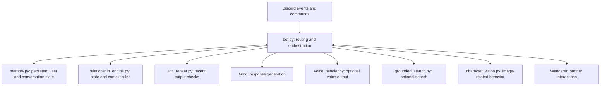

# Architecture and evidence map

Scaramouche is a Python Discord character bot with persistent conversation state, provider-backed responses, optional voice output, and interaction with Wanderer. This document maps the published repository. Deployed releases can differ; a case study is not proof that every newer feature exists on this branch.

## Boundaries

`bot.py` currently holds much of the orchestration. Large-file size is not a quality metric; progressively separating transport, provider access, memory, and delivery would improve maintainability. Such refactoring should be backed by tests and performed independently of documentation updates.

The offline tests exercise the actual `anti_repeat.py` implementation. They do not import `bot.py`, connect to Discord, or claim end-to-end coverage. The separate [repair lab](https://github.com/Kittybri/agent-repair-lab) tests simplified, explicit contracts for retrieval, routing, voice confidence, memory attribution, and complete delivery.

## Operational concerns

Provider errors, reconnects, duplicate events, memory attribution, and incomplete output are distinct failure modes. The [case studies](https://github.com/Kittybri/agent-repair-lab/tree/main/docs) explain specific evidence and tradeoffs. There are no published uptime, latency, accuracy, or model-comparison measurements.

User messages, voice data, memory databases, uploaded documents, and credentials are not demonstration fixtures. Use synthetic examples and review [PRIVACY.md](../PRIVACY.md) before operating the bot with other people.
